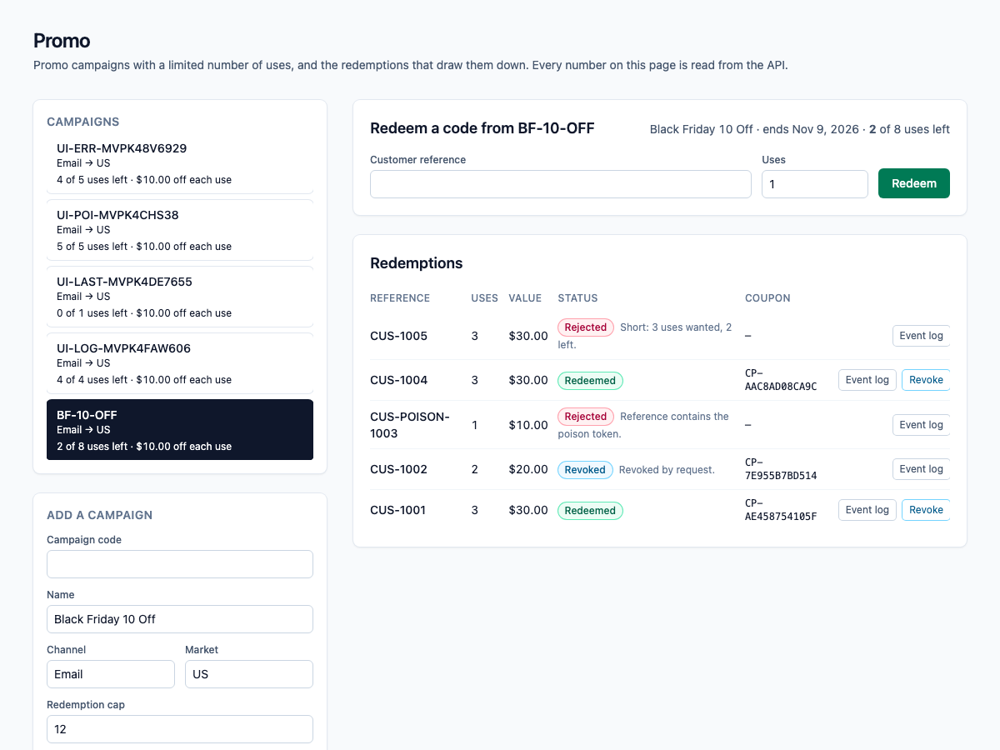
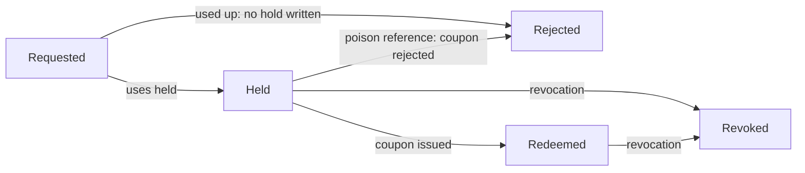
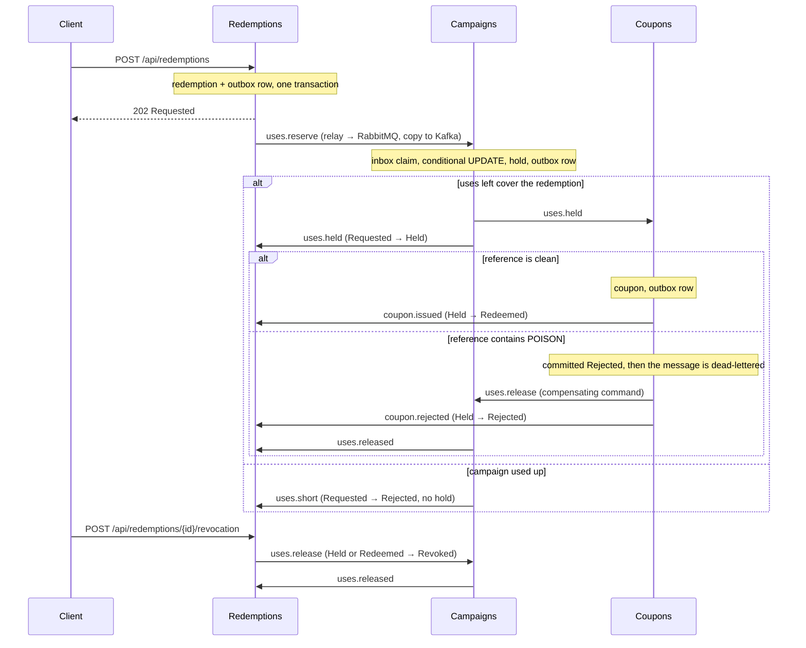

# dotnet-promo

Promo campaigns with a limited number of uses, and the redemptions that draw them down. The scarce number is the **uses left** on a campaign (a "first 500 customers" cap), and the **Campaigns** module is its only writer: it holds uses with a single conditional `UPDATE` that matches only while the uses left still cover the redemption, so when two customers fight for the last use, one commits a hold and the other is told the campaign is used up and no hold is written. A customer reference that contains the poison token `POISON` is committed as rejected by the Coupons module, the message is dead-lettered, and a compensating command gives the uses back. A later revocation also gives the uses back, but it does not roll back the coupon that was already issued.

One ASP.NET Core process, one Postgres database. An HTTP write saves the redemption and an outbox row in one local transaction; a `BackgroundService` relay publishes outbox rows to RabbitMQ (the work queue) and Kafka (the event log); the next module consumes from RabbitMQ, claims an inbox key in the same transaction as its own write, and writes its own row and outbox row. Saga steps never call each other in-process. Delivery is at-least-once: the relay can publish and crash before it marks a row sent, so the row goes out again, and every consumer dedupes with its inbox key. Each saga step only moves a redemption forward from the status it expects.

> The Compose network is local and unauthenticated. There is no login, no token-as-proof and no cookie. Do not publish these ports; Compose binds all of them to `127.0.0.1`.



*The UI reads everything from the API. Shown: redeemed codes, a revocation that gave 2 uses back and kept its coupon, a redemption rejected for the poison token, and one that was short.*

## Why this is a conditional update

Limited-use promo codes have a well-known bug: the code reads the usage counter, decides the code still has uses, and increments the counter later. Concurrent requests all pass the check. Recent advisories describe the same shape in several shops and ticketing tools: [Sylius CVE-2026-31824](https://advisories.gitlab.com/composer/sylius/sylius/CVE-2026-31824/) (the counter is read from an in-memory entity and written back as an absolute value at order completion), [alf.io CVE-2024-45300](https://devhub.checkmarx.com/cve-details/cve-2024-45300/) (a gap between checking the count and recording the redemption), [FOSSBilling CVE-2026-43927](https://app.opencve.io/cve/CVE-2026-43927) and [Hi.Events CVE-2026-57959](https://feedly.com/cve/CVE-2026-57959). Here the counter moves in one statement, `UPDATE ... SET UsesLeft = UsesLeft - n WHERE UsesLeft >= n`, and zero rows updated means the code is used up. A check constraint (`UsesLeft` between 0 and the cap) sits behind it. The race test was run against a read-then-write version, which is the CVE shape, and it fails.

## Money

Each use of a campaign is worth a fixed discount in cents, so a redemption's value is discount × uses, and three uses of a $10.00 discount are worth $30.00. A redemption is 1 to 3 uses. The arithmetic is `checked`: it throws instead of wrapping. The coupon is the record that the discount was granted; this repository does not apply it to a cart.

## Redemption statuses



`Revoked` and `Rejected` (after a hold) give the uses back through a `ReleaseUses` command, and Campaigns releases a hold at most once. The coupon has its own status (`Issued` or `Rejected`) and a revocation never changes it. If the revocation gets there before the final mark, the late mark finds the redemption is no longer `Held` and does nothing.

## How the modules talk



| Module | Owns | Consumes | Emits |
| --- | --- | --- | --- |
| **Redemptions** (`Modules/Redemptions`) | `Redemptions`: status, uses, value, customer reference. Validation, the poison rule, the value. | `uses.held`, `uses.short`, `coupon.issued`, `coupon.rejected`, `uses.released` | `uses.reserve`, `uses.release` (revocation) |
| **Campaigns** (`Modules/Campaigns`) | `Campaigns.UsesLeft` (sole writer after the campaign opens) and `UseHolds`. | `uses.reserve`, `uses.release` (prefetch 1) | `uses.held`, `uses.short`, `uses.released` |
| **Coupons** (`Modules/Coupons`) | `Coupons`. | `uses.held` | `coupon.issued`, `coupon.rejected`, `uses.release` (poison) |
| **Messaging** (`Messaging`) | `OutboxMessages`, `InboxMessages`, the relay, the consumer loop with retry and dead-letter, the Kafka log. | | |

RabbitMQ topology is declared in code (`Messaging/Topology.cs`): exchange `promo.work`, one queue per module (`campaigns.commands`, `coupons.work`, `redemptions.events`), a `.retry` queue per module (2 s TTL, then back to the main queue, 3 attempts), and a `.dlq` per module behind `promo.dlx`. A transient failure retries; a poison message goes straight to the dead-letter queue after its rejection is committed. Kafka has one topic, `promo.events`, one partition, replication factor 1, keyed by redemption id.

## Run it

Needs Node 22 (npm 10), .NET SDK 10.0.401 (`global.json`), Docker (arm64 is fine) and python3 for the smoke script.

```bash
npm ci
docker compose up -d --wait db        # dotnet test uses Postgres on 5480 (database promo_test)
dotnet test tests/api/Promo.Api.Tests.csproj
docker compose up --build --wait      # db, kafka, rabbitmq, api, web
./scripts/smoke.sh                    # last line: promo smoke passed
npx playwright install chromium       # once
npx playwright test                   # two specs against http://127.0.0.1:8100
docker compose down                   # keeps the Postgres volume; `down -v` drops it
```

| Service | Host port |
| --- | --- |
| Web (nginx, proxies `/api/`) | 8100 |
| API (`/scalar/v1`, `/api/health`) | 5220 |
| Postgres 17 | 5480 |
| Kafka 3.8.1 (KRaft, one broker) | 9130 |
| RabbitMQ 3.13 / management UI (`platform` / `platform`) | 5710 / 15710 |

Inside the Compose network the API and nginx listen on 8080 and Kafka's internal listener is 9092.

## Try it with curl

```bash
curl -s -X POST http://127.0.0.1:5220/api/campaigns \
  -H 'content-type: application/json' \
  -d '{"code":"BF-10-OFF","name":"Black Friday 10 Off","channel":"Email","market":"US","usesTotal":8,"discountCents":1000}'

curl -s -X POST http://127.0.0.1:5220/api/redemptions \
  -H 'content-type: application/json' \
  -d '{"campaignCode":"BF-10-OFF","reference":"CUS-1001","uses":3}'
# 202, status Requested, valueCents 3000. Use the returned id:

curl -s http://127.0.0.1:5220/api/redemptions/<id>           # Redeemed after a few seconds, with a coupon number
curl -s http://127.0.0.1:5220/api/coupons/<id>
curl -s http://127.0.0.1:5220/api/campaigns/BF-10-OFF        # usesLeft 5
curl -s http://127.0.0.1:5220/api/redemptions/<id>/events    # the Kafka log for this redemption

curl -s -X POST http://127.0.0.1:5220/api/redemptions/<id>/revocation \
  -H 'content-type: application/json'                        # uses go back to the campaign; the coupon stays
```

A redemption is validated at the door: customer reference required (at most 40 characters), 1 to 3 uses. The poison match is a case-sensitive substring: `CUS-POISON-7` and any longer token containing `POISON` match.

## Develop with Nx

The repository is an Nx workspace (`nx.json`, plugin `@nx/dotnet`). `npx nx show projects` lists `api` (the ASP.NET Core monolith), `web` (the Angular app) and the inferred xUnit project.

```bash
docker compose up -d --wait db kafka rabbitmq   # the brokers and Postgres, not the app
npx nx serve api                                # http://localhost:5220
npx nx serve web                                # http://localhost:4300, proxies /api to the API
WEB_URL=http://localhost:4300 npx playwright test   # the same browser specs, against the dev servers
npx nx run-many -t typecheck lint -p web        # tsc --noEmit and ESLint (angular-eslint)
npx nx build web && npx nx build api            # what CI builds
```

## What is tested, and where it runs

- **xUnit against real Postgres** (`tests/api`, 26 tests): two tasks with two `DbContext`s fight for one remaining use (one `Held`, one `Short`, uses left 0, no hold for the loser); empty input, over-limit input, integer overflow (4294967297 must not wrap to 1), the value and its checked arithmetic, the poison substring; the same message delivered twice is claimed once; a release returns the uses once; the poison rejection is committed before the dead-letter; a revocation followed by the late final mark leaves the redemption `Revoked` and the coupon `Issued`. The race test was run against a read-then-write version of the hold, where it failed, and against the conditional update, where it passes.
- **`scripts/smoke.sh`** drives the composed stack with a run id on every code, so a kept volume does not collide: validation, the happy path (value, coupon, Kafka log), three concurrent redemptions for one use (one redeemed, two short, no hold for the losers), the poison reference (rejected, `coupons.work.dlq` gains one message, uses restored), and a revocation that lands between the coupon and the final mark (redemption `Revoked`, coupon `Issued`, uses back, second revocation `409`). To make that last window wide enough to hit on purpose, Compose sets `Redemptions__FinalMarkDelayMs=1500`; it is a latency knob and defaults to 0.
- **Playwright** (`e2e/specs/redeem.spec.ts`): adds a campaign in the UI, redeems a code, sees `Redeemed` and the coupon number, reloads to prove the page reads the API and keeps nothing in `localStorage`, then revokes and sees the uses come back. A second spec, `e2e/specs/ui-flows.spec.ts`, drives the page through the refusal messages (over-limit, empty reference, duplicate), the poison rejection, the loser of a race for the last use, and the Kafka event log panel. Both specs pass against the Compose stack and against the Nx dev servers.
- **CI** (`.github/workflows/ci.yml`, on push) has two jobs. `verify`: `npm ci`, Prettier check, `dotnet format whitespace --verify-no-changes`, `dotnet test` with a Postgres 17 service, `nx typecheck` and `nx lint` for web (ESLint with angular-eslint, template accessibility rules included, zero warnings allowed), and `nx build` for web and api. `e2e`: builds the Compose stack on the runner, runs `scripts/smoke.sh` and both Playwright specs against it, uploads the Playwright traces and prints the Compose logs on failure.

## API

All routes are unauthenticated JSON. Interactive docs are at `http://127.0.0.1:5220/scalar/v1` (OpenAPI at `/openapi/v1.json`); the web port proxies `/api/`, `/scalar/` and `/openapi/` too.

| Method and path | What it does | Responses |
| --- | --- | --- |
| `GET /api/health` | Liveness. | `200 Healthy` |
| `POST /api/campaigns` | Opens a campaign with its redemption cap and a discount in cents per use. | `201`, `400` invalid, `409` code exists |
| `GET /api/campaigns` | Lists campaigns. | `200` |
| `GET /api/campaigns/{code}` | One campaign with the live uses left. | `200`, `404` |
| `POST /api/redemptions` | Accepts a redemption (1 to 3 uses) and starts the saga. | `202` Requested, `400` invalid, `404` unknown campaign, `409` duplicate reference |
| `GET /api/redemptions?campaignCode=` | Lists the latest 100 redemptions, optionally for one campaign. | `200` |
| `GET /api/redemptions/{id}` | One redemption and its status. | `200`, `404` |
| `POST /api/redemptions/{id}/revocation` | Moves a held or redeemed redemption to `Revoked` and gives the uses back. The coupon is not touched. | `202`, `404`, `409` wrong status |
| `GET /api/redemptions/{id}/events` | The Kafka event log for one redemption, read from the start of the topic. | `200` |
| `GET /api/coupons/{redemptionId}` | The coupon row. | `200`, `404` until the step has run |

Errors come back as `application/problem+json` with a `title`.

## Configuration

Compose sets these on the API container. Defaults in `apps/api/appsettings.json` point at the published host ports, so `nx serve api` works against `docker compose up -d --wait db kafka rabbitmq`.

| Setting | Compose value | Meaning |
| --- | --- | --- |
| `ConnectionStrings__Promo` | `Host=db;Port=5432;Database=promo;Username=promo;Password=promo` | The one Postgres database. Migrations run on startup. |
| `RabbitMq__Host` / `__Port` / `__User` / `__Password` | `rabbitmq` / `5672` / `platform` / `platform` | Work queue. Virtual host `/`. |
| `Kafka__BootstrapServers` | `kafka:9092` | Event log. |
| `Redemptions__FinalMarkDelayMs` | `1500` | Milliseconds the final mark waits. A latency knob so the smoke can land a revocation inside the window. `0` outside Compose. |
| `PROMO_TEST_DB` (tests only) | | Postgres connection for `dotnet test`. Defaults to `localhost:5480`, database `promo_test`. CI points it at its service container. |

## Look inside and fix things

```bash
docker compose ps                      # five services, all healthy
docker compose logs -f api             # relay, consumers, poison and retry lines
docker compose exec db psql -U promo -d promo -c 'select "RoutingKey","SentAt" from "OutboxMessages" order by "Id" desc limit 10'
open http://127.0.0.1:15710            # RabbitMQ management, platform / platform
```

- **Dead-lettered messages** sit in `coupons.work.dlq`. Nothing replays them; inspect them in the management UI. Retries wait in `<queue>.retry` for 2 seconds.
- **A port is already in use**: `lsof -nP -i :5220` shows who holds it. Compose publishes only on `127.0.0.1`.
- **`dotnet test` cannot connect**: start Postgres first with `docker compose up -d --wait db`.
- **The smoke cannot reach the API**: run `docker compose up --build --wait` first; override the target with `API=... RABBIT=... ./scripts/smoke.sh`.
- **Start clean**: `docker compose down -v` drops Postgres, Kafka and RabbitMQ data. Plain `down` keeps them, and the smoke is safe on kept data because every code carries a run id.
- **The Kafka log looks empty right after a redemption**: the relay publishes within a second or so; reload the event log.

## Known limits

- It is unauthenticated on purpose. Anything that can reach the API can read and write everything.
- It counts redemptions; it does not price a cart, check eligibility, enforce one use per customer, expire a campaign on its end date, or stop one customer using many references.
- Delivery is at-least-once, not exactly-once. The inbox makes repeats harmless for the saga; the Kafka log can hold a duplicate event after a relay crash.
- One broker, one partition, replication factor 1, one API instance. The relay does not coordinate across instances (the inbox would absorb the duplicates, but the outbox is never trimmed).
- `GET .../events` scans the whole topic for each call. Fine here, not something to expose at scale.
- Lists are capped at 100 rows and not paginated.
- Dead-lettered messages are not replayed automatically.
- The browser specs drive Chromium at a desktop size only, and the `e2e` CI job needs Docker and takes a few minutes.

## Cloud mapping

This repository runs on Compose. Nothing in it calls a cloud account.

| Here | On Azure |
| --- | --- |
| Postgres 17 | Azure Database for PostgreSQL |
| Kafka 3.8 | Event Hubs |
| RabbitMQ 3.13 | Service Bus queue with its dead-letter sub-queue |
| The API and the web app | Container Apps |

## Layout

```
apps/api      ASP.NET Core monolith: Modules/{Redemptions,Campaigns,Coupons}, Messaging, Data, Migrations
apps/web      Angular 21, styled with Tailwind 4 utilities only
tests/api     xUnit against Postgres
e2e/          Playwright
scripts/      smoke.sh
compose.yaml  Postgres, Kafka, RabbitMQ, API, web
```

Nx 23.2.1 orchestrates `nx build web`, `nx lint web`, `nx typecheck web` and `nx build api`; EF Core migrations are committed and the API applies them on startup.

## Other systems in this .NET track

- [dotnet-freight](https://github.com/joshbarros/dotnet-freight): container space on ocean sailings.
- [dotnet-clinic](https://github.com/joshbarros/dotnet-clinic): appointment slots in a provider session.
- [dotnet-ledger](https://github.com/joshbarros/dotnet-ledger): outgoing payments from an account balance.
- [dotnet-warehouse](https://github.com/joshbarros/dotnet-warehouse): warehouse stock and outbound orders.
- [dotnet-academy](https://github.com/joshbarros/dotnet-academy): course cohort seats and enrollments.
- [dotnet-compute](https://github.com/joshbarros/dotnet-compute): GPU-hour reservations in a pool.
- [dotnet-hotel](https://github.com/joshbarros/dotnet-hotel): hotel room-nights.
- [dotnet-tickets](https://github.com/joshbarros/dotnet-tickets): event ticket tiers and orders.
- [dotnet-carbon](https://github.com/joshbarros/dotnet-carbon): carbon credit batches and purchases.
- [dotnet-charging](https://github.com/joshbarros/dotnet-charging): EV charger slot reservations.
